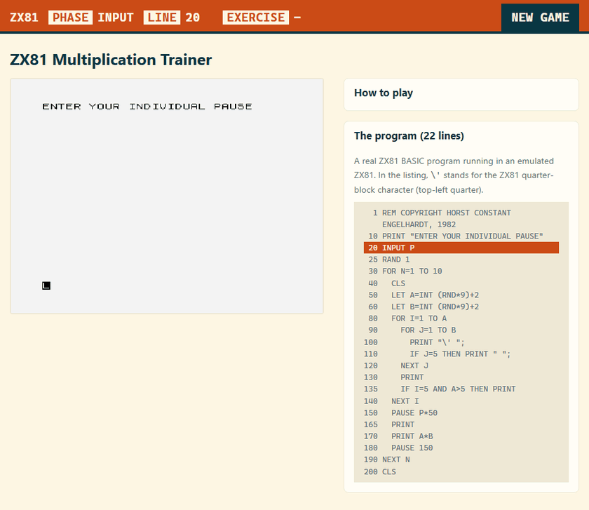

# ZX81 multiplication tables

A circa-1982 ZX81 BASIC multiplication trainer, run in the browser as a **real ZX81 BASIC program
inside an emulated ZX81**. JavaScript only hosts, instruments and presents it; the BASIC program is
never reimplemented in JavaScript.



The use: a player says the answer **out loud** before the program shows it. Ten multiplication
exercises per run. Each is drawn as a rows of b quarter blocks, with a and b between 2 and 10 (ZX81
semigraphics code 1, so every unit is visibly separated), and a gap after every fifth block across
and a blank line after the fifth row. The multiplication is not printed as numbers; the player
reads it off the drawing. The program then waits for the player's pause (1 to 99 seconds), prints a
blank line and shows the answer. After ten exercises it clears the screen and ends; the page then
shows "The game is over" with a New game button. New game is also in the status bar at the top,
which shows the phase, the BASIC line and the exercise number.

The page works in desktop and mobile browsers.

**Status:** the trainer in `src/basic/trainer.bas` follows the layout described by the project owner
(quarter blocks, groups of five, blank line above the result). It is still a reconstruction from
memory. The drawing lives in lines 80-140 and the glyph in line 100, so it can be changed in a few
lines. The BASIC is kept plain (no FAST/SLOW tricks); smoothing the display is the job of the
page's JavaScript.

## Web and mobile

- **Identity:** Solarized Light with an orange bar across the top, like the other cprima sites.
- **Kits:** the page loads [Web Awesome](https://webawesome.com/) (theme, utilities, native
  reset, loader) and Font Awesome Pro (via `data-fa-kit-code`) from your kits, the same way the
  sibling sites do. The kit code is domain-locked, so it is safe in public HTML; Pro font files
  and the npm token are never committed (a test checks that). The kits load without blocking: the
  stylesheets use `media="print" onload=...` and the loader script is `async`, so a slow or
  unreachable kit never keeps the game from starting. **The kits must allow the domain
  `career.cprima.net`** (kit settings at fontawesome.com and webawesome.com), otherwise the page
  simply looks as it does without them.
- **Navigation bar:** one horizontal status bar in Solarized orange (`src/web/nav.js`,
  `nav.css`): the phase, the BASIC line being executed and the exercise number, live from the
  emulator, plus the New game button. On a phone it scrolls sideways instead of wrapping.
- **Layout:** the game comes first, under the status bar and the heading. From 56 rem width the
  page has two columns: the game on the left, and on the right two collapsible panels, "How to
  play" (open on the first visit, then remembered) and "The program" (the BASIC listing, closed,
  with the executing line highlighted). On a phone everything is one column.
- **Phones:** one fluid column, the screen fills the width at 4:3, notch-safe spacing, touch
  targets of at least 44 px, no double-tap zoom delay, and an on-screen **number pad** (digits,
  delete, Enter) on touch screens, because a canvas shows no soft keyboard. `?keypad=1` shows the
  pad on desktop too.
- **Keys:** real keys and the pad go through one queue (`src/web/key-queue.js`). The ZX81 reads
  one key at a time, once per frame, so every key is held at least 60 ms and the next key waits
  25 ms; this keeps fast typing and quick taps from being lost.

## Run it locally

```bash
npm install
just dev          # builds the site, serves http://localhost:8765/
```

The port can be changed with `ZX81_PORT=9000 just dev`. Do not open the pages through `file://`:
the emulator loads its ROM and program with HTTP requests.

Requirements: node, npm, [just](https://just.systems/), bash with `xxd`, [uv](https://docs.astral.sh/uv/) (runs the small
Python file server), and a C compiler for `zxtext2p` (native `gcc`, or `gcc` inside WSL on Windows).

## Pages and URL parameters

| URL                               | What                                                                                                                                  |
| --------------------------------- | ------------------------------------------------------------------------------------------------------------------------------------- |
| `/`                               | launches the trainer                                                                                                                  |
| `/?program=NAME`                  | runs `tapes/NAME.p.hex` (hello, arithmetic, graphics, keyboard, delay, line0, trainer, trainer-seeded)                                |
| `/?debug=1`                       | developer panel (state, frame, emulated time, last key, PC, memory, pause/run/step, reset, PNG capture); `window.zx81` is the adapter |
| `/?emulator=mock&scenario=normal` | mock emulator, no Z80; scenarios `normal`, `slow`, `load-error`, `runtime-error`, `blank-screen`, `finished`                          |
| `/?speed=0..8`                    | emulator speed index (4 = real time, 8 = 10x); emulated frame counts do not change                                                    |
| `/?renderer=emulator`             | show the emulator's own TV-raster picture instead of the page's drawing of the screen (see below)                                     |
| `/debug/charset.html`             | every ZX81 semigraphics character, drawn from the ROM bitmaps                                                                         |

### How the screen is shown

The emulator draws a TV picture from emulated scanlines. While the ZX81 is busy that picture can
skew (rows shifted sideways) and `CLS` wipes the picture from top to bottom over several frames.
So by default the page reads the ZX81's screen memory (the display file) every emulated frame and
draws it itself on a canvas, using the glyph bitmaps of the original ROM. Drawing and typing show
at once; when the program clears the screen, the old picture stays until the screen is completely
cleared and is then replaced in one step (a hard cut). The logic is in `src/web/screen-presenter.js`
and is unit-tested. The emulator still runs underneath, unchanged. Your keyboard goes to the
emulated ZX81 from anywhere on the page.

All URLs are relative, so the site also works below `https://USER.github.io/REPOSITORY/`.
`just dev` additionally serves it under `/zx81-trainer/` to prove that.

## How it fits together

```text
src/basic/*.bas  --zxtext2p-->  build/*.p  --xxd-->  public/tapes/*.p.hex
                                                        |
vendored ZX81 emulator (JtyOne, JavaScript) <-- adapter (src/emulator/emulator-adapter.js)
                                                        |
                                           src/web (page, debug panel) --> public/

src/basic/*.phases.json  (BASIC line ranges -> phase names, loop counter variable)
                         --> src/web/phases.js --> status bar
```

- **No TZX step.** The emulator loads a `.P` file directly when the URL ends in `.p` and the server
  returns ASCII hex (`zx81.html?tzx=../tapes/trainer.p` fetches `../tapes/trainer.p.hex`).
- **Autorun.** `zxtext2p` leaves the "next line to run" pointer at the end of the program, so a
  loaded program would only be listed. `tools/build-program.sh` points it at the first line.
- **Adapter.** Application code uses only the `ZX81Emulator` interface; the real emulator and the
  mock implement it. Emulator internals stay behind it.
- **Emulator patches** are kept minimal and listed in `src/emulator/zx81/PATCHES.md`. The rule:
  patch the emulator only when a failing fixture or a required adapter feature proves it necessary.
- **Fixtures** (`src/basic`): `hello`, `arithmetic`, `graphics` (every semigraphics code),
  `keyboard`, `delay` (the trainer's busy-loop delay), `line0` (a BASIC line numbered 0, which
  cannot be typed on a ZX81 keyboard), `trainer`, and `trainer-seeded` (identical to the trainer
  except `RAND` becomes `RAND 1`, so the random exercises are reproducible).

## Tests

```bash
just test           # unit tests (node), no network, no browser
just test-browser   # Playwright: emulator integration, trainer behaviour, mock, Pages paths
just capture        # artifacts/screen.png, debug.txt, display-file.bin for a known exercise
just lint           # ESLint, Prettier check, Stylelint, html-validate, type check, knip
just format         # rewrite all files in the project's code style
just ci             # lint, then the unit tests
just gif            # the animation at the top: rushes, then the cut (needs ffmpeg)
```

`just gif` plays the first two exercises and photographs every screen change into
`artifacts/rushes/` (`just rushes`), then cuts them into `artifacts/demo.gif` following
`tools/gif-playbook.json` (`just gif-edit`, which can be re-run alone). The brief and the playbook
are explained in [docs/gif-video-brief.md](docs/gif-video-brief.md). Copy the result to
`docs/demo.gif` to update the README.

`just lint-shell`, `just lint-py`, `just lint-md` and `just lint-actions` check the shell scripts,
the Python helper, the Markdown and the workflows (the tools are fetched on demand through uv).

- Emulator integration tests check the ROM boots, programs load and run, the screen changes,
  semigraphics are emitted with exact ZX81 codes and rendered as the original glyphs
  (pixel regression in `test/browser/__screenshots__`), and the keyboard works.
- Trainer tests check ten exercises, operands against an independently computed ZX81 `RND`
  sequence, correct answers, the gap after every fifth block, the pause scaling the delay, and
  completion. A failure here points at the BASIC program, not the emulator.
- Timing is measured in emulated frames (50 per emulated second), never wall-clock time.
- Text forms of the screen (`[Q1]` for semigraphics) exist only for tests and diagnostics; they
  are not the authentic display.

## Deployment

`.github/workflows/pages.yml` tests, runs `just build` and publishes `public/` with GitHub Pages
(`.nojekyll` is included). `test.yml` runs the tests and the capture on every push, and `lint.yml`
runs the linters and checkers (the `just lint*` recipes) on every push.

## Licences

- Own code (adapter, mock, web page, tests, BASIC programs, tools): Apache-2.0, see `LICENSE`.
- `src/emulator/zx81/` (and its copy in `public/emulator/`): the emulator
  [hammingweight/zx81-javascript-emulator](https://github.com/hammingweight/zx81-javascript-emulator),
  GPL-2.0, derived from JtyOne by Simon Holdsworth. Upstream licence kept in
  `src/emulator/zx81/LICENSE`; the patches are described in `PATCHES.md`.
- `tools/zxtext2p/`: ZXText2P by Chris Cowley (based on zmakebas by Russell Marks), GPL.
- ZX81 ROM image: Sinclair/Nine Tiles ROM as distributed with the emulator.

The deployed site contains the GPL-2.0 emulator next to Apache-2.0 code. Check that this mix is
what you want before publishing; see `NOTICE`.
